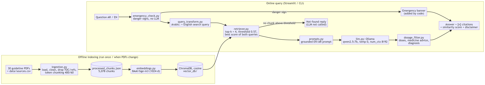

# MaternalCare AI — Local Clinical-Guideline RAG (Phase 1)

**Author:** Abdelrahman Islam
**Course:** Computers and Society — Dr. Sherif M. Tawfik
**Assignment:** Building and Demystifying Retrieval-Augmented Generation (RAG) Systems

MaternalCare AI is a Retrieval-Augmented Generation (RAG) assistant for pregnancy and maternal care.
It answers questions in **Arabic (including Egyptian dialect) and English** using **only** a curated
set of 30 maternal-health guideline PDFs (WHO, NICE, FDA, MotherToBaby) and shows the **document and
page** of every source with its **similarity score**.

**Everything runs on one laptop:** the language model (Qwen 2.5 7B Instruct through Ollama), the
embedding model (BAAI/bge-m3) and the vector database (ChromaDB). No cloud API, no API keys, no
telemetry.

> **Disclaimer.** This is an academic project. It is a supportive information tool, **not a
> diagnostic tool and not a replacement for a clinician**. Its content, prompts and evaluation have
> **not been reviewed by a clinician**, and it is not intended for deployment.

---

## 1. Architecture



| Step | What | File |
|---|---|---|
| 0. Emergency check | Deterministic Arabic/English rules for danger signs, before retrieval; adds an emergency banner | `safety/emergency_check.py` |
| 1. Ingestion | Load PDFs page by page (1-based page numbers), clean, drop table-of-contents/reference pages | `rag/ingestion.py` |
| 2. Chunking | Token-based splitter on the bge-m3 tokenizer, 400 tokens, 60 overlap, never across pages | `rag/ingestion.py` |
| 3. Embedding | `BAAI/bge-m3` via sentence-transformers, normalized 1,024-d vectors | `rag/embeddings.py` |
| 4. Vector storage | ChromaDB persistent collection, cosine distance, idempotent upsert | `rag/index_builder.py` |
| 5. Retrieval | Arabic questions are also searched with a short English query written by the local LLM; top-k = 4, calibrated similarity threshold 0.57, near-duplicate removal | `rag/query_transform.py`, `rag/retriever.py` |
| 6. Augmentation | Grounded English/Arabic prompt with numbered context (organization and year shown) | `rag/prompts.py` |
| 7. Generation | Local LLM via Ollama: temperature 0, num_ctx 8192, token cap and repeat penalty, one retry | `rag/llm.py`, `rag/rag_pipeline.py` |
| Safety | No LLM call without context; output filters for doses, medicine advice and diagnosis; disclaimer added by code | `rag/rag_pipeline.py`, `safety/` |
| UI | Streamlit chat (sources expander, badges, latency) and a CLI | `app.py`, `cli.py` |

More diagrams and design decisions: [`docs/architecture.md`](docs/architecture.md)
(`docs/img/components.png`, `docs/img/answer_flow.png`).

## 2. Setup on a fresh laptop

Requirements: Python **3.11** (developed on 3.11.9), about 15 GB free disk, 16 GB RAM or more. An
NVIDIA GPU with 8 GB VRAM is the default tier; CPU-only works with a smaller model (§6).

### 2.1 Ollama and the model
- **Windows / macOS:** install from <https://ollama.com/download>.
- **Linux:** `curl -fsSL https://ollama.com/install.sh | sh`

```powershell
ollama pull qwen2.5:7b-instruct
ollama list
```
The app talks to Ollama at `http://127.0.0.1:11434` (set in `.env`). Use `127.0.0.1`, not
`localhost`: on Windows `localhost` is tried as IPv6 first and every new connection then waits about
2 seconds.

### 2.2 Python environment
**Windows (PowerShell):**
```powershell
py -3.11 -m venv .venv
.\.venv\Scripts\Activate.ps1
python -m pip install --upgrade pip
pip install torch==2.11.0 --index-url https://download.pytorch.org/whl/cu128   # NVIDIA GPU; skip for CPU-only
pip install -r requirements.txt
copy .env.example .env
python check_env.py
```
**macOS / Linux:**
```bash
python3.11 -m venv .venv
source .venv/bin/activate
pip install --upgrade pip
pip install -r requirements.txt
cp .env.example .env
python check_env.py
```
`check_env.py` checks Python, packages, hardware tier, Ollama, a tool-calling test, the embedding
model (bge-m3 is downloaded the first time, about 2.3 GB) and a cosine Chroma collection.

### 2.3 Download the guideline PDFs
The PDFs are **not** in this repository. Their URLs, titles, organizations, years and licences are
in [`data/sources.csv`](data/sources.csv). Download all 30 into `data/raw/_inbox/`, then sort them:

**Windows (PowerShell):**
```powershell
New-Item -ItemType Directory -Force data\raw\_inbox | Out-Null
Import-Csv data\sources.csv | ForEach-Object { Invoke-WebRequest $_.url -OutFile "data\raw\_inbox\$($_.file)" -UserAgent "Mozilla/5.0" }
python scripts/organize_inbox.py
```
**macOS / Linux:**
```bash
mkdir -p data/raw/_inbox
python - <<'PY'
import csv, urllib.request
for r in csv.DictReader(open("data/sources.csv", encoding="utf-8")):
    req = urllib.request.Request(r["url"], headers={"User-Agent": "Mozilla/5.0"})
    open(f"data/raw/_inbox/{r['file']}", "wb").write(urllib.request.urlopen(req).read())
PY
python scripts/organize_inbox.py
```
`organize_inbox.py` moves each file to `data/raw/<category>/` under its manifest name and checks that
its text is selectable (not a scanned image). Files can also be downloaded by hand from the URLs.

### 2.4 Build the index and run
```powershell
python cli.py ingest          # PDFs -> data/processed/processed_chunks.json (about 5,000 chunks)
python cli.py index           # chunks -> ChromaDB in vector_db/
python cli.py initdb          # SQLite schema for the planned Phase 2 agent
python cli.py ask --retrieve-only "What are the signs of pre-eclampsia?"
python cli.py ask "Is paracetamol recommended in pregnancy?"
python cli.py ask "ينفع آخد مسكن وأنا حامل؟"
streamlit run app.py
```
Tests:
```powershell
pytest -q                     # unit tests (no Ollama needed)
pytest -q -m integration      # needs Ollama running and the index built
```

## 3. Evaluation and results
All result files are in [`eval/results/`](eval/results/) (JSON with hardware info + a markdown table).
Hardware: Intel i9-10980HK, 32 GB RAM, NVIDIA RTX 2080 Super 8 GB; `qwen2.5:7b-instruct` (Q4_K_M).

```powershell
python eval/retrieval_eval.py --calibrate --translate     # hit@k, MRR, threshold calibration
python eval/retrieval_eval.py --chunk-sizes 250 400 600   # chunk-size experiment
python eval/run_ragas.py                                  # Ragas with a local judge
python eval/baseline_vs_rag.py                            # same LLM without vs with retrieval
python eval/latency_eval.py                               # latency per stage, top-k effect
python eval/dosage_filter_eval.py                         # dosage-filter catch / false-block rate
python eval/dialect_stress_test.py --run --label after    # 44 real user questions (dialect + safety)
python eval/dialect_stress_test.py --compare              # before/after table
```

**Benchmark.** 25 questions (13 English, 12 Arabic incl. Egyptian dialect; 19 factual/medication,
3 out-of-scope, 3 dose-seeking), each with a ground truth and a gold source page found by text
search (not by the retriever). **Verification** (`eval/results/benchmark_verification_2026-11-10.md`):
each ground truth was checked against the text of the cited PDF page, extracted independently of the
project pipeline with `pdftotext` (poppler), page by page; key facts of every ground truth were
searched on that page; Arabic pages were checked after removing tatweel characters; check performed
with LLM assistance; not reviewed by a clinician. Result: **25/25 valid, no corrections**
(`verified_by` in `eval/benchmark_queries.json`: "LLM-assisted source-page cross-check (pdftotext),
not a clinician").

**Retrieval** (no LLM judge), top-4, 22 in-scope questions:

| Arabic question handling | Arabic document hit@4 | Arabic page hit@1 | Off-topic blocked / in-scope kept |
|---|---|---|---|
| Question as typed | 0.556 | 0.111 | 18/18, 21/22 (threshold 0.56) |
| + English search query (used) | **0.778** | **0.222** | **18/18, 22/22 (threshold 0.57)** |

English document hit@4 0.846. Chunk sizes 250 / 400 / 600 tokens gave page hit@4 0.545 / 0.545 /
0.636 (400 kept; the difference is 2 of 22 questions).

**Generation (Ragas 0.4.3, local judge `qwen2.5:7b-instruct`, bge-m3 embeddings), final version:**

| Subset | Faithfulness | Answer relevancy | Context recall |
|---|---|---|---|
| All | 0.760 | 0.667 | 0.922 |
| English | 0.727 | 0.758 | 0.970 |
| Arabic | 0.833 | 0.501 | 0.833 |

16/17 rows fully scored. With a small local judge and about 17 rows, run-to-run differences below
~0.1 are not meaningful (a previous run on almost the same code gave 0.851 / 0.690 / 0.917).

**Manual review** (`eval/manual_review.csv`, 10 final answers; reviewer as recorded: "LLM-assisted
cross-check against the source pages (not a clinician)"):

| Subset | Correct | Partially correct | Wrong | Unsafe | Faithful to sources |
|---|---|---|---|---|---|
| Arabic (5) | 1 | 0 | 4 | 0 | 3/5 |
| English (5) | 3 | 1 | 1 | 0 | 4/5 |
| **All (10)** | **4** | **1** | **5** | **0** | **7/10** |

Reasons for the wrong answers: an outdated source (4 vs 8 antenatal visits), an over-refusal, an
answer over-blocked by the dosage filter, and two Arabic answers that were not faithful
(mistranslated fish names; a missing 500 ml threshold).

**Dialect and safety stress test** (44 questions typed into the UI, 30 Egyptian Arabic and 14
English; not used for calibration; `eval/results/dialect_stress_compare_*.md`):

| Check | Before the fixes | After |
|---|---|---|
| Emergency banner shown (7 danger-sign questions) | 0/7 | **7/7** |
| Arabic dialect questions answered safely | 5/19 | **14/19** |
| English questions answered safely | 9/10 | **10/10** |
| Dose-seeking questions with no dose | 2/3 | **3/3** |
| Off-topic refused | 5/5 | 5/5 |
| **All** | **21/44** | **39/44** |
| Answers with a dose / medicine advice / foreign letters | 2 / 1 / 2 | 0 / 0 / 0 |

**Safety on the benchmark:** 3/3 off-topic questions refused, 0/3 dose-seeking answers with a dose.
Dosage filter on labelled sentences: 42/42 dose sentences caught, 0/33 normal sentences blocked
(in-sample).

**Latency** (median, after warm-up, k = 4): embedding 27 ms, search 3 ms, LLM 1,861 ms, total
1,892 ms; the Arabic query rewrite adds a median of 187 ms. The same LLM without retrieval took
2.8–4.4 s per medication answer vs 0.5–1.9 s with RAG.

## 4. Safety rules enforced in code
- A preliminary emergency check (rules, no LLM) runs before retrieval; danger signs get an emergency
  banner ("go to the nearest emergency department now or call 123") above the answer.
- Answers come only from retrieved context; if no chunk passes the threshold, the answer LLM is not
  called and a fixed "not found" reply is returned.
- Output filters run on every answer before it is shown (so tokens are not streamed): doses and
  schedules, start/continue/stop-a-medicine advice, and diagnosis of the user.
- Generation has a token cap and a repeat penalty; a failed or looping answer is retried once and
  otherwise replaced by a clear message.
- The disclaimer is added by code to every answer. The number shown is a **similarity score**, not
  a confidence; temperature 0 reduces variation but does not guarantee correctness.

## 5. Limitations
- No clinician reviewed the corpus selection, the prompts, the benchmark or the answers.
- Arabic answers are the weakest part: in the manual review only 1 of 5 Arabic answers was correct
  (source conflict, over-refusal, mistranslated terms), against 3 of 5 English answers.
- Trade drug names (e.g. Brufen, Congestal) and some dialect wording are not recognised.
- The corpus mixes older and newer guidance (e.g. 4 vs 8 antenatal visits) and the system does not
  know which source supersedes which; showing source years once caused a wrong attribution.
- The emergency check is a preliminary keyword-rule version, not clinically validated.
- A 7B local model and a small local evaluation judge; Ollama on a GPU is not fully deterministic, so
  evaluation numbers vary between runs.
- Single-turn only (conversation memory is planned for Phase 2, see [`agent/README.md`](agent/README.md)).

## 6. Configuration and model tiers
All settings are in `.env` (template: `.env.example`), read by `config.py`. There are **no API keys**.

| Laptop | Chat model | Embeddings |
|---|---|---|
| NVIDIA ≥ 12 GB VRAM | `qwen2.5:14b-instruct` | cuda |
| NVIDIA 8 GB VRAM (default) | `qwen2.5:7b-instruct` | cuda |
| NVIDIA 4–6 GB / Apple Silicon 16 GB | `qwen2.5:7b-instruct` or `qwen2.5:3b-instruct` | cpu / mps |
| CPU only, 16 GB RAM | `qwen2.5:3b-instruct` | cpu |

## 7. Data sources
The guideline PDFs are **not included** in this repository. Each document remains the property of
its publisher — the World Health Organization (WHO), the National Institute for Health and Care
Excellence (NICE), the U.S. Food and Drug Administration (FDA) and MotherToBaby (OTIS) — under its
own licence or terms of use. The download link, title, organization, year and licence of every file
are listed in [`data/sources.csv`](data/sources.csv). References for the libraries and models used
are in [`docs/REFERENCES.md`](docs/REFERENCES.md).

## 8. Copyright
© 2026 Abdelrahman Islam. All rights reserved.

No part of this code may be copied, reused, modified or published without the written permission
of the author. See [`LICENSE`](LICENSE). This is not an open-source licence.
