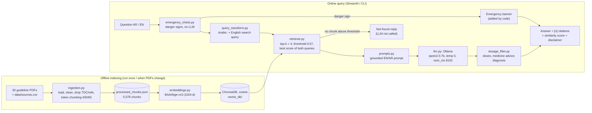
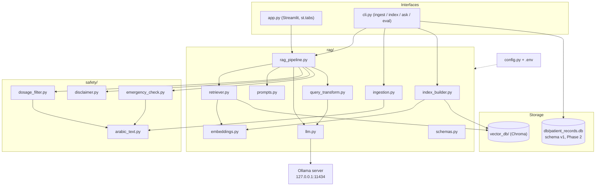
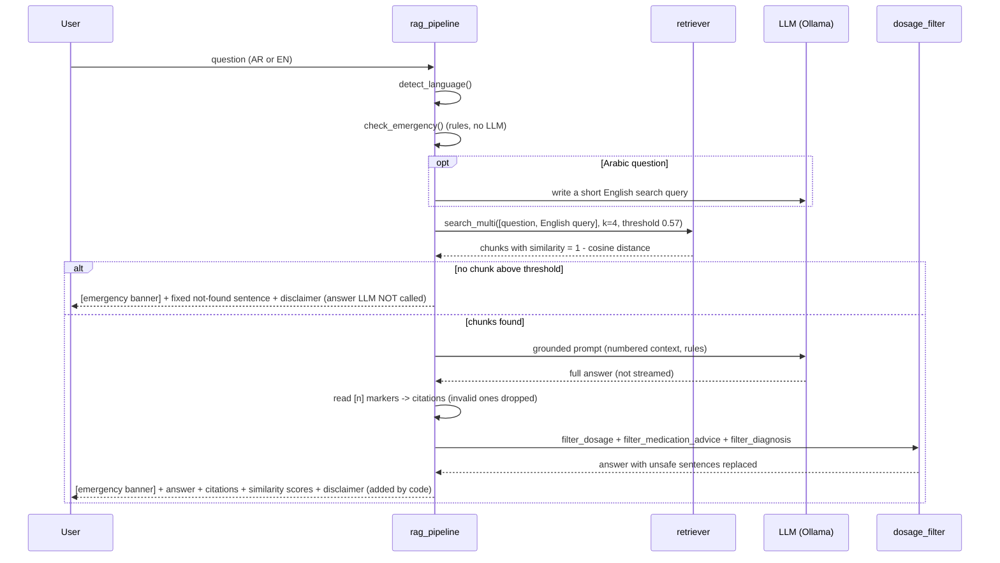

# Architecture — MaternalCare AI (Phase 1, local RAG)

Rendered images: `docs/img/pipeline.png`, `docs/img/components.png`, `docs/img/answer_flow.png`.
The diagrams below are Mermaid; GitHub renders them directly.

## 1. Pipeline: offline indexing and online query (all on one laptop)

## 2. Components and files

## 3. answer_question(): where each safety rule is enforced in code

## 4. Design decisions (short)

| Decision | Why |
|---|---|
| Fully local (Ollama, bge-m3, Chroma) | Health questions never leave the laptop (privacy, Egyptian Law 151/2020); no API keys or costs |
| bge-m3 embeddings | Multilingual: an Arabic question finds English guideline text; 8,192-token window |
| Token-based chunks of 400 / overlap 60, never across pages | Measured in the embedder's own tokens; one page per chunk = exact page citations |
| Cosine distance, similarity = 1 − distance | Vectors are normalized; cosine compares direction (meaning), not length |
| Calibrated threshold (0.57) | Chosen from in-scope vs out-of-scope top-1 similarities (eval/retrieval_eval.py), with the query transformation on |
| Emergency check before retrieval, no LLM | Danger signs must get the 'go to emergency now' message even if nothing is retrieved; deterministic rules are testable (preliminary, full interceptor in Phase 2) |
| Arabic → English search query | Egyptian-dialect questions were far from the English guideline text; searching with both raised Arabic document hit@4 from 0.56 to 0.78 |
| Generation limits + one retry (num_predict, repeat_penalty) | Ollama aborted one answer with "token repeat limit reached"; the rewrite and the answer now have token caps, a retry, and a clear message instead of an error |
| `127.0.0.1` instead of `localhost` | On Windows `localhost` tries IPv6 first and each new connection waited ~2 s (measured 2,483 ms vs 324 ms) |
| Output filters in code (dose, medicine advice, diagnosis) | The 7B model broke these prompt rules in the manual test; code filters make the rules hold |
| No LLM call without context | The model cannot invent an answer when nothing relevant was found |
| Dosage filter after generation, no streaming | The prompt alone cannot guarantee "no doses"; the filter must see the full answer first |
| Chroma called directly | Full control over the distance function, IDs (idempotent upsert) and metadata |
| `st.tabs` UI, stable function interfaces | Phase 2 adds tabs and wraps `retrieve()` as an agent tool without rewriting |
